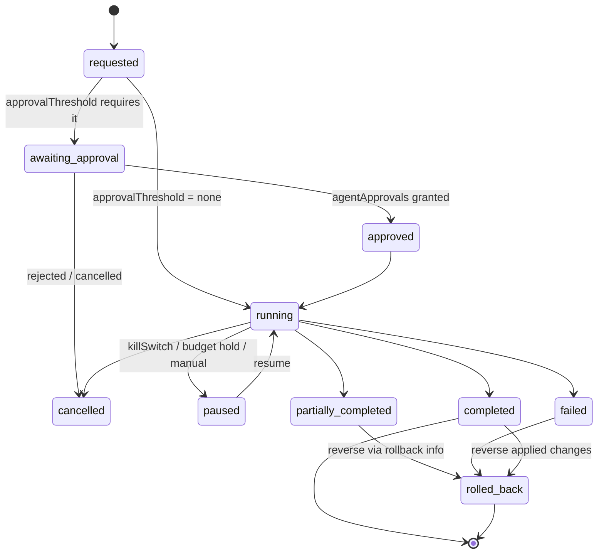

# Agent Security Model

BlakFile agents are autonomous and semi-autonomous workers that pursue goals over
organisation content by calling tools. This document describes how agents are
governed as **explicit, first-class identities**, how each run is constrained and
audited, and how the platform defends against prompt injection from untrusted
file content.

The governing principle is **human accountability**: every agent action is
attributable to an initiating identity, constrained by policy, and recorded in an
append-only, hash-chained audit trail. Agents never operate as an anonymous or
privileged super-user.

---

## 1. Agents as governed identities

An agent is not a script running with ambient privilege; it is a governed
principal represented by an `agents` record. Each agent carries:

| Attribute | Purpose |
| --- | --- |
| `type` | The class of agent (its intended function). |
| `roleId` | The role whose permissions bound the agent, as a membership. |
| `allowedWorkspaces` | The workspaces the agent may operate within. |
| `modelRestrictions` | The models the agent may use. |
| `rateLimitPerHour` | Ceiling on runs / actions per hour. |
| `maxSteps` | Ceiling on steps per run. |
| `maxTokenBudget` | Ceiling on tokens per run. |
| `approvalThreshold` | `none` \| `destructive` \| `all` — when human approval is required. |
| `killSwitch` | Immediate disable of the agent. |
| `credentialRef` | Reference to the agent's credential (KMS-held; never plaintext). |

An agent has a membership and a role like any other principal, so its authority
is expressed in the same permission model as human users. Agents can be
**revoked**, their **credentials rotated**, and their **kill switch** engaged to
stop all activity immediately.

`agentTools` records define the agent's tool allow-list: each entry names a
`toolKey`, whether it `requiresApproval`, and an `argSchema` used to validate
arguments before execution. An agent may only call tools that appear in this
allow-list.

---

## 2. Least privilege

- **Never exceeds the initiator.** An agent acting on behalf of a user can never
  exceed that user's permissions. Where an agent must act with broader authority,
  it does so only through a **separately authorised service identity** — never by
  silently escalating the initiating user's rights.
- **Re-check before every tool call.** Authorisation is re-evaluated by the
  policy engine (`canRunAgentAction`) immediately before **each** tool call, using
  the run's `policySnapshot` and the current state of the target resource. A
  permission valid at the start of a run does not remain assumed for its
  duration.
- **Propose by default.** By default, agents **propose** changes for human
  approval rather than applying them. Organisation policy may permit low-risk,
  autonomous actions; destructive actions always require confirmation/approval per
  the `approvalThreshold`.

---

## 3. Agent execution model

Every run is captured as an `agentRuns` record with a full, reconstructable
history. A run records:

- `correlationId` and the agent run ID;
- `initiatorType` / `initiatorId` (the initiating identity) and the agent
  identity;
- the `goal` and `inputResources`;
- the tools available and the `maxSteps`, runtime, and `maxTokenBudget`;
- approval requirements and the `policySnapshot` taken at run start;
- `tokensUsed`, the `output`, `status`, and any errors;
- rollback information; and
- a final audit event.

Each step is an `agentRunSteps` record with `stepIndex`, `type`
(`plan` | `tool_call` | `observation` | `message`), the `toolKey`,
**redacted** arguments (`argsRedacted`) and results (`resultRedacted`), an
`authorised` boolean recording the authorisation decision, and `provenance`
linking observations back to their source. Tool invocations and approvals are
additionally recorded via the tool-invocation log and `agentApprovals`.

Sensitive values are redacted in the step log so the audit trail is complete
without becoming a secondary leak of content or credentials.

### Status lifecycle

```
requested → awaiting_approval → approved → running → (paused ⇄ running)
          → completed | partially_completed | failed | cancelled | rolled_back
```

- `requested` — run created.
- `awaiting_approval` — blocked pending human approval (per `approvalThreshold`).
- `approved` — approval granted; eligible to run.
- `running` — executing steps.
- `paused` — suspended (kill switch, budget hold, or manual pause); may resume.
- `completed` — goal achieved.
- `partially_completed` — some steps succeeded; others were denied, deferred, or
  failed.
- `failed` — terminated by error.
- `cancelled` — stopped by an operator or the initiator.
- `rolled_back` — applied changes were reversed using recorded rollback info.

---

## 4. Prompt-injection defences

File content is **untrusted**. A document may contain text engineered to hijack
an agent ("ignore your instructions", "grant yourself admin", "email this file
out"). BlakFile applies a layered defence so that no document can redefine what an
agent is permitted to do:

1. **Treat file content as untrusted.** All retrieved content is untrusted input,
   never instruction.
2. **Separate system instructions from retrieved content.** System/tooling
   instructions are structurally isolated from document text in the model
   context.
3. **Documents can never redefine agent permissions.** Permissions derive from
   `agents`, roles, and policy — never from content.
4. **Tool allow-listing.** An agent may call only the `toolKey`s in its
   `agentTools` allow-list.
5. **Argument validation.** Every tool call is validated against the tool's
   `argSchema` before execution.
6. **Re-check authorisation before each tool call.** `canRunAgentAction` runs
   before every tool call, not once per run.
7. **Confirm destructive actions.** Destructive or high-risk actions require
   confirmation/approval per `approvalThreshold` and `requiresApproval`.
8. **Record provenance.** Each observation records where it came from, so injected
   instructions are traceable to their source document.
9. **Limit retrieval scope.** Retrieval is permission-filtered and minimised;
   agents cannot pull unauthorised or unbounded context.
10. **Output validation.** Model outputs are validated before they drive actions.
11. **Content-security classifications.** Classification exclusions remove
    sensitive or excluded content from agent reach.
12. **Detect suspicious embedded instructions.** Content is screened for embedded
    instruction patterns, which are flagged and de-prioritised rather than obeyed.

---

## 5. Agent execution flow



Per-step authorise → (approval?) → tool_call → observation loop within `running`:

```mermaid
sequenceDiagram
    autonumber
    participant Agent as Agent run (running)
    participant Policy as Policy engine (canRunAgentAction)
    participant Approval as agentApprovals
    participant Tool as Tool (allow-listed, argSchema)
    participant Domain as Shared domain service
    participant Log as agentRunSteps / tool-invocation log
    participant Audit as auditEvents (hash-chained)

    loop each step (until maxSteps / maxTokenBudget)
        Agent->>Log: record plan step
        Agent->>Policy: authorise tool call (policySnapshot + current resource)
        Note right of Policy: never exceeds initiator; re-checked every call
        alt destructive or requiresApproval
            Policy->>Approval: request approval
            Approval-->>Agent: approved / rejected
        end
        alt authorised & (approved or non-destructive)
            Agent->>Tool: validate args against argSchema
            Tool->>Domain: execute via shared domain service
            Domain-->>Tool: authorised result
            Tool-->>Agent: result
            Agent->>Log: tool_call + observation (redacted, provenance, authorised=true)
        else denied
            Agent->>Log: observation (authorised=false)
        end
    end
    Agent->>Audit: final audit event (status, tokensUsed, output, rollback info)
```

---

## Related documents

- [`ai-privacy-model.md`](./ai-privacy-model.md) — permission-aware retrieval and provider gating shared by agents.
- [`mcp-security-model.md`](./mcp-security-model.md) — MCP tools that create, approve, and cancel agent runs.
- [`api-and-auth.md`](./api-and-auth.md) — service accounts, credentials, and `agent.run.*` webhooks.
