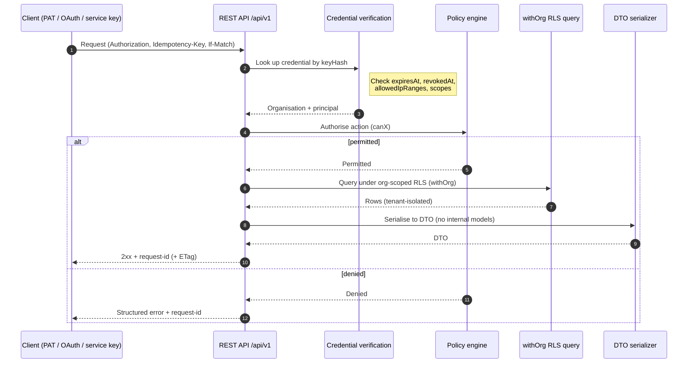
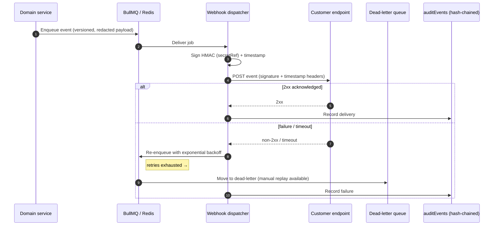

# REST API, Authentication, and Webhooks

BlakFile is **API-first**. The web application, REST API, MCP server, and
background workers all call the **same domain services**, so the REST API is a
faithful, first-class surface of the platform rather than a thin afterthought.
This document describes the REST API design, authentication options, and the
webhook delivery system.

---

## 1. REST API design

### Versioning

The API is versioned under `/api/v1`. Breaking changes are introduced under a new
version; within a version, changes are additive and backward-compatible.

### Resources

The API exposes domain resources such as workspaces, folders, files, file
versions, shares, access requests, comments, review requests, data rooms, file
requests, tags, classifications, agents, agent runs, API clients, webhooks, and
audit events. **Internal database models are never exposed.** Every response is a
domain **DTO** produced by an explicit serializer, decoupling the wire contract
from the storage schema.

### Collections

Collection endpoints support:

- **Cursor pagination** — opaque, stable cursors (not offset-based) for
  consistent traversal of large, mutating collections.
- **Filtering, sorting, and field selection** — constrained to documented,
  indexed fields.

### Requests and responses

- **Idempotency keys** — mutating requests accept an idempotency key so retries
  are safe and do not create duplicates.
- **Request / correlation IDs** — every request is assigned a request ID and
  carries a `correlationId` returned to the client and threaded through logs and
  audit events.
- **Structured errors** — errors use a consistent, machine-readable envelope
  (stable error code, human-readable message, and request ID) — never leaking
  internal detail.
- **Rate limits** — enforced per credential, with standard rate-limit headers.
- **ETags and conditional requests** — resources return ETags; clients use
  `If-Match` / `If-None-Match` for optimistic concurrency and cache validation.
- **Deprecation headers** — deprecated endpoints and fields emit deprecation
  headers with sunset information.

### Specification

The API is described by an **OpenAPI 3.1** document, which is the source of truth
for resources, schemas, and error envelopes.

---

## 2. Authentication

BlakFile supports multiple authentication methods, all resolving to a principal
and organisation before the policy engine runs.

| Method | Consumer | Notes |
| --- | --- | --- |
| **Session cookies** | Web application | Interactive browser sessions. |
| **Personal access tokens** | Scripts / individuals | Act as the issuing user; scoped. |
| **OAuth clients + scopes** | Third-party integrations | Delegated access constrained by granted scopes. |
| **Service accounts** | Automation / backend | Non-interactive identities with their own permissions. |
| **API keys** | Machine clients | See handling rules below. |

API clients are represented by `apiClients` records (`personal_access` |
`oauth` | `service`, with `scopes` and `allowedIpRanges`), supported by
`serviceAccounts` and `oauthClients`.

### Credential handling (`apiCredentials`)

Credentials are handled to a strict standard:

- **`keyHash` only, never plaintext.** Only a hash of the secret is stored;
  the raw secret is shown once at creation and never again.
- **`prefix`** — a non-secret prefix supports display and lookup.
- **Rotation** — credentials can be rotated without downtime.
- **`expiresAt`** — credentials may carry an expiry.
- **`revokedAt`** — credentials can be revoked immediately.
- **Last-used tracking** — last-used metadata supports monitoring and cleanup.
- **IP restrictions** — `allowedIpRanges` restricts where a credential may be
  used.

### Verification flow (every request)

1. Extract the credential and look it up by **hash** (never plaintext).
2. Verify it is **not expired**, **not revoked**, within **`allowedIpRanges`**,
   and carries the required **scope**.
3. Resolve the **organisation and principal**.
4. Evaluate the **policy engine** for the requested action.
5. Execute domain queries under **org-scoped row-level security** (`withOrg`).
6. Serialise the result to a **DTO** and return it with the request ID.

---

## 3. Webhooks

Webhooks deliver platform events to customer endpoints reliably and securely.

### Event catalogue

Events are namespaced and versioned, including (non-exhaustive):

- `file.*` — e.g. `file.created`, `file.updated`, `file.deleted`,
  `file.version.created`.
- `share.*` — e.g. `share.created`, `share.revoked`.
- `access.*` — e.g. `access.requested`, `access.approved`.
- `malware.detected`
- `dlp.match.detected`
- `agent.run.*` — e.g. `agent.run.requested`, `agent.run.awaiting_approval`,
  `agent.run.completed`, `agent.run.failed`, `agent.run.rolled_back`.

### Security and reliability

- **HMAC signatures.** Each delivery is signed with an HMAC using a per-endpoint
  secret referenced by `secretRef`. Receivers verify the signature before
  processing.
- **Replay protection.** A signed timestamp is included; receivers reject stale
  deliveries outside the tolerance window.
- **Exponential backoff.** Failed deliveries are retried with exponential
  backoff.
- **Dead-letter.** Deliveries that exhaust retries are moved to a dead-letter
  queue.
- **Manual replay.** Operators can manually replay dead-lettered or historical
  events.
- **Payload redaction.** Payloads are redacted so that sensitive content and
  credentials are never delivered.
- **Event versioning.** Event schemas are versioned so payload evolution does not
  break receivers.

Webhook dispatch and retries run on the same BullMQ / Redis worker
infrastructure as the rest of the platform, and every delivery is correlated and
audited.

---

## 4. API authentication and request flow

## 5. Webhook delivery flow

---

## 6. One platform, one set of domain services

The REST API, the web application, the MCP server, and the workers are all
**consumers of the same domain services**. Authorisation, tenant isolation,
serialisation to DTOs, and auditing are implemented **once** in that shared layer,
so no consumer can bypass a control that another enforces. This API-first design
is what makes BlakFile's security guarantees uniform across every surface.

---

## Related documents

- [`ai-privacy-model.md`](./ai-privacy-model.md) — AI provider gating and permission-aware retrieval.
- [`agent-security-model.md`](./agent-security-model.md) — agent governance behind `agent.run.*` events.
- [`mcp-security-model.md`](./mcp-security-model.md) — MCP authentication and tool authorisation.
