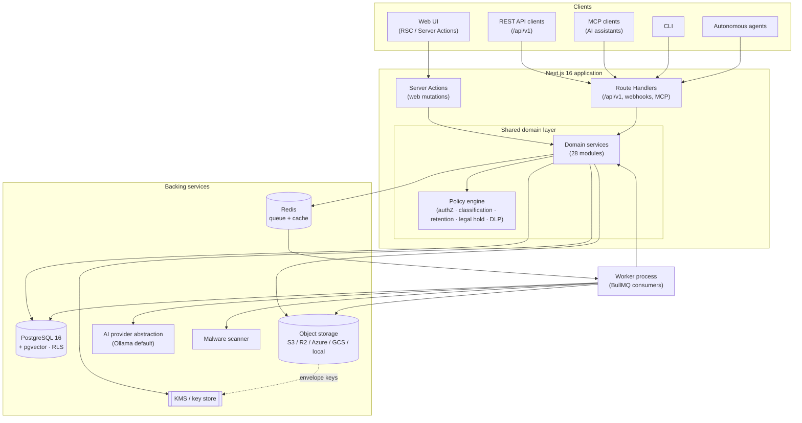
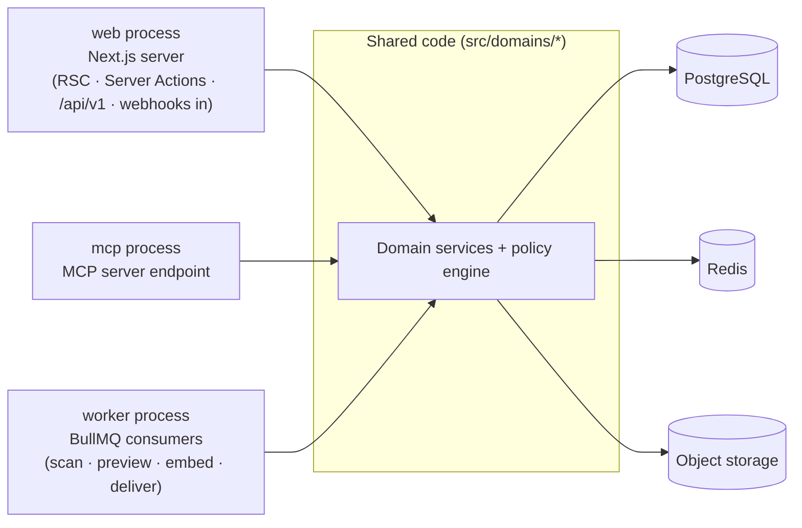

# BlakFile — Architecture

BlakFile is a secure, AI-native, multi-tenant enterprise file platform. It stores
files and their versions on behalf of many organisations (tenants) on shared
infrastructure, exposes them through several first-class interfaces, and applies
a consistent authorisation, classification, retention and audit model to every
access — regardless of which interface made the request.

This document describes the platform's design principles, system architecture,
domain module map, runtime topology and deployment targets. For the persistence
model see [`data-model.md`](./data-model.md); for the tenant-boundary guarantees
see [`tenant-isolation.md`](./tenant-isolation.md).

## Design principles

- **Security and privacy by default.** Share links are private by default and
  public sharing is off by default. Signed storage URLs are short-lived (120s)
  and use opaque, random object keys that encode neither filename nor tenant.
  AI processing is disabled unless an organisation explicitly opts in. Every
  server boundary authorises; there is no client-side filtering used as a
  security control.
- **Every interface is first-class, and they all share one core.** The web UI
  (React Server Components), the REST API (`/api/v1`), the MCP server, webhooks
  and the background worker are all thin adapters over the **same domain
  services**. Business rules, authorisation and audit live in the domain layer,
  not in any single transport. An action taken over MCP is subject to the same
  policy checks as the same action taken in the browser.
- **Multi-tenant isolation is enforced in depth.** Tenant separation is not a
  query convention; it is enforced at the database (PostgreSQL Row-Level
  Security), storage, cache, queue, search and logging layers. See
  [`tenant-isolation.md`](./tenant-isolation.md).
- **Self-hostable and provider-neutral.** Storage (`s3` / `r2` / `azure` /
  `gcs` / `local`), the job queue (Redis/BullMQ or a Postgres-backed
  alternative) and the AI provider (Ollama by default) are all abstracted behind
  driver interfaces. BlakFile can run entirely on infrastructure the operator
  controls.
- **Australian data sovereignty.** BlakFile can be deployed wholly within
  Australian sovereign cloud or on-premises environments, with no dependency on
  external SaaS AI or storage services. Data residency is tracked per file.
- **Auditability is non-negotiable.** Security- and compliance-relevant events
  are written to an append-only, hash-chained audit log.

## System architecture

All client types converge on the same Next.js application, which delegates to a
single shared domain layer and policy engine. No interface has a private path to
the data stores.

Key points:

- **One funnel.** Route Handlers and Server Actions never talk to Postgres,
  storage or the queue directly for tenant data; they call domain services,
  which apply the policy engine before any effect.
- **The worker is a peer client of the domain layer,** not a bypass. Jobs
  dequeued from Redis re-enter through the same domain services, carrying the
  tenant context that was validated when the job was enqueued.
- **Heavy and untrusted work is deferred.** Malware scanning, preview
  generation, text extraction, embedding and webhook delivery run in the worker,
  keeping request handlers fast and keeping unscanned bytes out of the servable
  set until cleared.

## Domain module map

The 28 modules under `src/domains/*`. Each owns its services and is the only
sanctioned entry point to its tables.

| Module | Responsibility |
| --- | --- |
| `organisations` | Tenants, domains, membership, teams and groups. |
| `identity` | Users, sessions, accounts, passkeys, MFA factors, trusted devices. |
| `authorisation` | Roles, permissions, role assignments, access requests and reviews. |
| `administration` | Tenant administration and operational controls. |
| `workspaces` | Workspaces, drives and folder hierarchy. |
| `files` | File identity, immutable versions, locks/check-out. |
| `storage` | Storage provider drivers, storage objects, encryption key references. |
| `uploads` | Upload sessions and multipart upload part tracking. |
| `previews` | Rendered previews and extracted text per file version. |
| `metadata` | Tags, labels, custom metadata schemas and values. |
| `classifications` | Sensitivity classifications and file-to-classification bindings. |
| `retention` | Retention policies, assignments and disposition reviews. |
| `legal-hold` | Legal holds and the resources they freeze. |
| `dlp` | Data-loss-prevention scans and findings. |
| `malware` | Malware scan orchestration and verdicts. |
| `sharing` | Internal shares, recipients, share links and access events. |
| `external-collaboration` | External users, invitations, file requests and submissions. |
| `search` | Vector embeddings and semantic/keyword search. |
| `ai` | AI providers, AI policies, AI jobs and generated outputs. |
| `agents` | Agent definitions, tools, runs, run steps and human approvals. |
| `mcp` | MCP clients, sessions and tool-invocation records. |
| `api` | API clients, credentials, service accounts, OAuth clients. |
| `webhooks` | Webhook subscriptions, events and delivery attempts. |
| `integrations` | Outbound/inbound integration connectors. |
| `notifications` | User notifications and delivery preferences. |
| `audit` | Append-only hash-chained audit and security events. |
| `usage` | Usage records, quotas and feature flags. |
| `billing` | Plans, entitlements and billing state. |

> Some modules span more than one schema file, and some schema files (for
> example identity providers and processing) back a module without being a
> module of their own. The mapping of the **95 tables** to modules is tabulated
> in [`data-model.md`](./data-model.md#table-to-module-map).

## Runtime topology

BlakFile is one codebase run as (at least) three process roles, all importing
the same `src/domains/*` layer:

- **web** serves the UI and synchronous API/MCP/webhook-receipt traffic. RSC is
  the default; mutations run through Server Actions or Route Handlers.
- **worker** consumes queued jobs. It scales independently of the web tier and
  is where AI, malware and media processing happen.
- **mcp** exposes the Model Context Protocol server. It can run in-process with
  the web tier or as a separate process; either way it is an adapter over the
  domain layer, and its tokens are bound to a single organisation.

Because all roles share the domain layer, a policy or authorisation change is
applied uniformly the moment it ships — there is no per-transport re-implementation
to keep in sync.

## Deployment targets

BlakFile is delivered as containers with a `docker-compose.yml` for local and
single-host deployment and is designed for Kubernetes in production.

| Target | Notes |
| --- | --- |
| AWS | S3 storage driver, RDS/Aurora PostgreSQL 16 (with pgvector), ElastiCache Redis, KMS. |
| Azure | `azure` blob driver, Azure Database for PostgreSQL, Azure Cache for Redis, Key Vault. |
| GCP | `gcs` driver, Cloud SQL for PostgreSQL, Memorystore, Cloud KMS. |
| Cloudflare R2 | `r2` storage driver for object storage. |
| Australian sovereign cloud | Fully in-region deployment with in-region storage, database and self-hosted AI (Ollama) — no external SaaS dependency. |
| Kubernetes | Separate Deployments for `web`, `worker` and `mcp`; horizontal scaling of the worker tier. |
| Docker Compose | Single-host all-in-one for evaluation and small deployments. |
| Air-gapped / on-premises | `local` storage driver (MinIO or filesystem), self-hosted Postgres/Redis, local Ollama, local malware engine. |

### Air-gapped mode — what degrades

In a fully air-gapped deployment (no outbound internet), the platform remains
functional for storage, sharing, classification, retention, legal hold and
audit. The following degrade or must be provisioned locally:

- **AI features** require a locally hosted model (Ollama). If none is provided,
  AI, embeddings and semantic search are unavailable; keyword/metadata search
  and the rest of the platform continue to work.
- **Malware scanning** requires locally installed signatures; automatic
  signature updates are unavailable, so signatures must be side-loaded.
- **Outbound webhooks and third-party integrations** can only reach endpoints
  reachable inside the enclave.
- **Public share links** are only usable by parties with network access to the
  deployment.

## Related documents

- [`data-model.md`](./data-model.md) — persistence conventions, ER diagram and the
  full table-to-module map.
- [`tenant-isolation.md`](./tenant-isolation.md) — the per-layer tenant boundary
  guarantee and how it fails closed.
