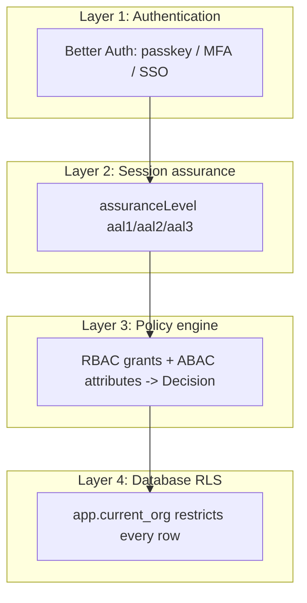
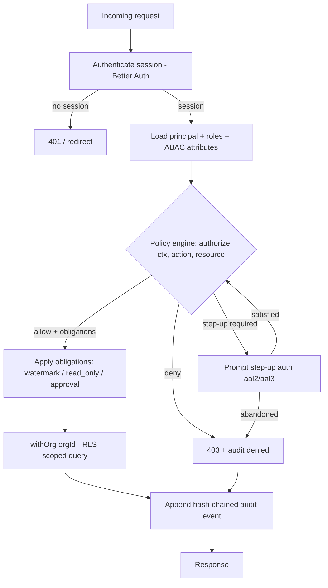

# Authorisation Model

This document describes how BlakFile decides whether a principal may perform an
action on a resource. Authorisation is **centralised**, evaluated at **every
server boundary**, and enforced again at the database layer. No security
decision is made in a UI component, and no client-supplied claim is trusted.

## Layered model (defence in depth)

Authorisation is a pipeline of independent layers. A request must satisfy every
layer; failure at any layer denies the request.

1. **Authentication (Better Auth).** Establishes *who* the principal is:
   passkeys/WebAuthn, TOTP MFA, recovery codes, magic links, or federated
   SAML/OIDC SSO. SCIM keeps the principal set in sync with the customer's IdP.
   The outcome is a session bound to a `userId` and an active
   `organisationId`.

2. **Session assurance level.** Every session carries an
   `assuranceLevel` (`aal1` password/single factor, `aal2` MFA, `aal3`
   phishing-resistant passkey/hardware). High-risk actions require a minimum
   assurance level; if the session is below it, the policy engine returns a
   **step-up** obligation rather than a hard deny.

3. **Policy engine (RBAC + ABAC).** The single place where an allow/deny is
   computed. RBAC grants (`roleAssignments`) establish the baseline of what a
   principal *may* do; ABAC policies constrain that baseline using request-time
   attributes (classification, device trust, geo/IP, legal-hold state, and so
   on). Decisions combine under **deny-overrides**.

4. **Database Row-Level Security (RLS).** The last line of defence. Even if an
   application-layer check were bypassed by a bug, PostgreSQL RLS restricts
   every tenant-scoped row to the caller's organisation. The application role
   `blakfile_app` is `NOBYPASSRLS`.



Authorisation is re-checked at **every** server boundary — REST route handlers,
Server Actions, MCP tool endpoints, webhook processors, and, critically,
**before every agent/MCP tool call** (not merely at the start of an agent run).

## The policy engine

### Reusable policy functions

Every privileged operation resolves to exactly one policy function. These are
the only sanctioned decision points; product code must not re-implement checks
inline.

| Policy function | Governs |
| --- | --- |
| `canReadFile` | Reading file metadata / opening a file record |
| `canDownloadFile` | Retrieving file bytes (issuing a signed URL) |
| `canPreviewFile` | Rendering a generated preview (no raw bytes) |
| `canShareFile` | Creating a share to an internal principal |
| `canCreatePublicLink` | Creating an anonymous/tokenised link |
| `canInviteExternalUser` | Granting access to an external email |
| `canDeleteFile` | Soft-delete (recoverable) |
| `canRestoreFile` | Restoring a soft-deleted file |
| `canPermanentlyDeleteFile` | Irreversible purge |
| `canModifyClassification` | Changing classification/sensitivity labels |
| `canApplyLegalHold` | Placing/lifting a legal hold |
| `canUseAIWithFile` | Submitting file content to an AI operation |
| `canRunAgentAction` | Executing an autonomous agent tool call |
| `canCreateApiCredential` | Minting API keys / service credentials |
| `canAccessAuditLogs` | Reading the audit trail |
| `canExportData` | Bulk export of files/metadata |

### Shape of a decision

A policy function takes a fully-resolved input and returns a structured
decision. Inputs are:

- **Principal + attributes** — identity, principal type (`user`, `group`,
  `team`, `service_account`, `agent`), effective roles, employment type,
  session `assuranceLevel`/MFA state, device trust, geo/IP, session risk.
- **Resource** — the target and its attributes: classification, sensitivity,
  data residency, retention state, legal-hold state, owner/custodian.
- **Context** — time, request origin, correlation/request IDs, whether the call
  originates from a human, an API client, an agent, or an MCP client.
- **Required permission** — a catalogue key such as `file.read`.

The output is:

- `allow: boolean`
- `reason: string` — machine- and human-readable justification (recorded in
  audit on denial and on obligated allows).
- `obligations` — conditions the caller must satisfy for the allow to take
  effect, e.g. `step_up` (raise assurance level), `watermark` (render with a
  visible watermark), `require_approval`, `read_only`.

### Engine signature

```ts
type PrincipalType = "user" | "group" | "team" | "service_account" | "agent";

interface AuthzContext {
  principal: {
    id: string;
    type: PrincipalType;
    organisationId: string;
    roles: string[];           // effective role keys at the relevant scope
    employmentType?: string;   // e.g. employee | contractor | external
  };
  session: {
    assuranceLevel: "aal1" | "aal2" | "aal3";
    mfaSatisfied: boolean;
    deviceTrusted: boolean;
    ip: string;
    geo?: string;
    risk: "low" | "medium" | "high";
  };
  origin: "web" | "api" | "agent" | "mcp";
  now: Date;
}

interface ResourceRef {
  type: "file" | "folder" | "drive" | "share" | "audit" | "credential";
  id: string;
  organisationId: string;
  classification?: "public" | "internal" | "confidential" | "restricted";
  sensitivity?: "low" | "medium" | "high";
  dataResidency?: string;
  legalHold?: boolean;
  retentionState?: "active" | "retained" | "pending_deletion";
}

type Obligation =
  | { kind: "step_up"; to: "aal2" | "aal3" }
  | { kind: "watermark" }
  | { kind: "require_approval" }
  | { kind: "read_only" };

interface Decision {
  allow: boolean;
  reason: string;
  obligations: Obligation[];
}

/**
 * The single authorisation entry point. `action` selects the policy function;
 * `requiredPermission` is the catalogue key it enforces.
 */
declare function authorize(
  ctx: AuthzContext,
  action: keyof PolicyRegistry,
  resource: ResourceRef,
): Decision;
```

### Worked example: `canDownloadFile`

Download is a common high-value action, so it exercises RBAC, ABAC and
obligations together.

```ts
function canDownloadFile(ctx: AuthzContext, res: ResourceRef): Decision {
  // 1. RBAC baseline: does any effective grant confer file.download at scope?
  if (!hasPermission(ctx, "file.download", res)) {
    return { allow: false, reason: "no_grant:file.download", obligations: [] };
  }

  // 2. ABAC: restricted content requires a trusted device (deny-overrides).
  if (res.classification === "restricted" && !ctx.session.deviceTrusted) {
    return { allow: false, reason: "untrusted_device_for_restricted", obligations: [] };
  }

  // 3. ABAC: confidential content requires MFA — but only step up, don't deny.
  const obligations: Obligation[] = [];
  if (
    (res.classification === "confidential" || res.classification === "restricted") &&
    ctx.session.assuranceLevel === "aal1"
  ) {
    obligations.push({ kind: "step_up", to: "aal2" });
  }

  // 4. Legal hold does NOT block a read/download — evidence must remain
  //    accessible to authorised custodians — but it DOES block deletion
  //    (see canPermanentlyDeleteFile below). A watermark is still applied.
  if (res.legalHold) {
    obligations.push({ kind: "watermark" });
  }

  return { allow: true, reason: "granted:file.download", obligations };
}

function canPermanentlyDeleteFile(ctx: AuthzContext, res: ResourceRef): Decision {
  if (res.legalHold) {
    // Legal hold is dispositive: no principal may purge held content.
    return { allow: false, reason: "blocked:legal_hold", obligations: [] };
  }
  if (!hasPermission(ctx, "file.purge", res)) {
    return { allow: false, reason: "no_grant:file.purge", obligations: [] };
  }
  // Irreversible action always requires phishing-resistant assurance.
  if (ctx.session.assuranceLevel !== "aal3") {
    return { allow: true, reason: "granted:file.purge", obligations: [{ kind: "step_up", to: "aal3" }] };
  }
  return { allow: true, reason: "granted:file.purge", obligations: [] };
}
```

Key asymmetry demonstrated: **legal hold does not block read/download** (it adds
a watermark obligation) but **does block permanent deletion**. This encodes the
records-management rule that held evidence must remain readable yet
undestroyable.

## Built-in roles

Roles with `organisationId = null` are system roles shared across all tenants;
tenants may also define custom roles scoped to their organisation. Effective
permissions are the **union** of all matching `roleAssignments` at or above the
resource's scope; ABAC policies then constrain that union.

| Role | Typical grants |
| --- | --- |
| Platform super admin | Cross-tenant operational administration; explicitly excluded from tenant file contents by policy and RLS. Highly privileged, minimally used, always audited (including impersonation). |
| Organisation owner | Full control of a single tenant, including billing, SSO/SCIM, custom roles. |
| Organisation admin | Tenant administration excluding ownership-transfer/billing. |
| Security / compliance officer | Audit access, legal holds, access reviews, DLP triage. |
| Workspace / drive manager | Manage members, shares and structure within a scope. |
| Editor | Create, edit and version files within a scope. |
| Commenter | Comment without modifying content. |
| Downloader | Preview and download. |
| Viewer | Preview only (no raw bytes). |
| External collaborator | Time-boxed, link/invite-scoped access to specific resources only. |
| Service account | Non-human integration principal, constrained by explicit scopes. |
| AI agent identity | Lowest-trust principal. Holds **no ambient permissions**; acts only within an explicitly granted role and per-tool authorisation, with approval thresholds for destructive actions. |

### How RBAC and ABAC combine

- **RBAC establishes the ceiling.** Without a matching grant, the answer is
  always deny — attributes can never *add* permission.
- **ABAC lowers the ceiling.** Attributes (classification, device trust, geo,
  assurance level, legal/retention state, session risk) can deny or attach
  obligations to an otherwise-granted action.
- **Deny-overrides.** If any applicable policy denies, the request is denied,
  regardless of how many grants would otherwise allow it.

## Row-Level Security

RLS is the defence-in-depth backstop beneath the policy engine.

- Every tenant-scoped table carries a non-null `organisation_id`.
- The active tenant is set per transaction via the session variable
  `app.current_org`.
- The RLS policy on each table is, in effect:
  `USING (organisation_id = current_setting('app.current_org')::uuid)`.
- The application connects as `blakfile_app`, which is **`NOBYPASSRLS`** — it
  cannot see across tenants even with a buggy or missing `WHERE` clause.

Application code never sets `app.current_org` ad hoc. It uses a single wrapper
that binds the context to the transaction:

```ts
/**
 * Runs `fn` inside a transaction with app.current_org bound to `orgId`.
 * Every tenant-scoped query MUST execute inside withOrg. The setting is
 * transaction-local (set_config(..., true)), so it cannot leak across pooled
 * connections.
 */
async function withOrg<T>(orgId: string, fn: (tx: Tx) => Promise<T>): Promise<T> {
  return db.transaction(async (tx) => {
    await tx.execute(sql`select set_config('app.current_org', ${orgId}, true)`);
    return fn(tx);
  });
}
```

Because the setting is transaction-scoped, RLS holds even under connection
pooling: a leaked or reused connection carries no residual tenant context.

## End-to-end request flow



Every decision — allow, deny, or obligated allow — produces an entry in the
append-only, hash-chained `auditEvents` table
(`hash = H(prevHash || canonical(event))`). Audit rows record the principal,
action, resource reference, outcome, assurance level and correlation ID, and
**never** contain file contents, passwords, tokens or keys. See
[security-model.md](./security-model.md) for the audit integrity controls and
[threat-model.md](./threat-model.md) for the abuse cases these layers mitigate.
