# Data Lifecycle & Governance

> Applies to: BlakFile — secure, AI-native, multi-tenant enterprise file platform.
> Audience: records managers, legal/compliance, platform engineers.

Content in BlakFile moves through a governed lifecycle from creation to defensible disposition. Two overriding controls sit above ordinary user actions: **legal hold** and **retention**. Neither can be bypassed by a user request to delete.

---

## 1. The content lifecycle

1. **Creation.** A file is created through the secure upload pipeline (see `upload-pipeline.md`) and becomes `available`.
2. **Active use.** The file is read, shared, commented on, and edited. `files.id` is a stable identity; content lives in immutable `fileVersions`.
3. **Versioning.** Each edit creates a new `fileVersions` row (`versionNumber`, `storageObjectId`, `checksumSha256`, `isCurrent`); `files.currentVersionId` advances.
4. **Classification.** A sensitivity label is applied (`fileClassifications`) — manually, by policy, by DLP, or as an AI suggestion. The label's `handlingRules` drive sharing, download, watermark, AI, and retention defaults.
5. **Retention scheduling.** A `retentionPolicies` rule is bound via `retentionAssignments`; `computedDispositionAt` is derived from the policy `trigger` (`creation` | `last_modified` | `event` | `custom_metadata`) plus `retainForDays`.
6. **Disposition review.** When due, a `dispositionReviews` record captures a human decision (`destroy` | `retain` | `extend`).
7. **Archive or destroy.** Approved disposition either archives (cold storage class) or destroys the content, issuing a **destruction certificate**.

**Legal hold** is an overriding branch: at any point a `legalHolds` record may scope a resource (via `legalHoldResources`), freezing it against deletion regardless of retention state.

---

## 2. Lifecycle diagram

```mermaid
flowchart TD
    U[Upload / creation] --> AV[Available &#40;active&#41;]
    AV --> V[New version created]
    V --> AV
    AV --> C[Classification applied]
    C --> RA[Retention assignment&#58; state=active]
    RA -->|computedDispositionAt reached| DUE[state=due]

    DUE --> HOLDCHK{Under legal hold?}
    HOLDCHK -->|Yes| HELD[state=held&#58; deletion BLOCKED]
    HELD -->|Hold released| DUE

    HOLDCHK -->|No| RETCHK{Retention satisfied?}
    RETCHK -->|No&#58; retain/extend| RA
    RETCHK -->|Yes| REVIEW{requiresDispositionReview?}

    REVIEW -->|Yes| DR[dispositionReviews&#58; human sign-off]
    REVIEW -->|No| ACT[Apply retention action]
    DR -->|approved destroy| ACT
    DR -->|retain / extend| RA

    ACT -->|action=archive| ARC[archived &#40;cold&#41;]
    ACT -->|action=delete| PD[pending_deletion]
    PD -->|grace / trash| AV
    PD -->|confirmed| DEL[deleted + cryptographic erase]
    DEL --> CERT[Destruction certificate issued]

    ARC --> DUE
```

Deletion is **gated twice**: once by legal hold, once by unsatisfied retention. Only an approved disposition with no active hold reaches `deleted`, which yields a destruction certificate.

---

## 3. Precedence rules

**Legal hold > retention > user deletion.**

- A **legal hold** (`legalHolds.status = active` scoping the resource) overrides everything. While held, the file cannot be permanently deleted, its retention `state` shows `held`, and any deletion request is denied and audited. **A user can NEVER permanently delete content under legal hold.**
- **Retention** overrides ordinary user deletion. If retention is unsatisfied, a user's "delete" moves the file to `pending_deletion` (recoverable) but cannot reach `deleted`.
- A **user deletion** only takes effect when *both* gates are clear: no active hold, retention satisfied (and disposition review approved where required).

### `pending_deletion` vs `deleted` vs cryptographic erase

| State / action | Meaning | Recoverable? |
| --- | --- | --- |
| `pending_deletion` | Soft-deleted; in trash / grace window. `deletedAt` set. | Yes — restorable to `available`. |
| `deleted` | Logical record removed from user view; terminal. | No. |
| **Cryptographic erase** | Object DEK/KEK destroyed in KMS so bytes are unrecoverable. | No — this is the physical enforcement of `deleted`. |

Cryptographic erase (see `storage-architecture.md` §3.4) is how BlakFile makes deletion *defensible*: destroying the key renders the ciphertext permanently unreadable, even where a backend cannot guarantee immediate physical overwrite. Both `pending_deletion → deleted` and cryptographic erase are hard-blocked while a legal hold applies.

---

## 4. Versioning semantics

- **Immutable versions.** Each `fileVersions` row is write-once; edits never mutate an existing version's bytes or checksum.
- **Stable identity.** Shares, permissions, links, comments, and audit references bind to `files.id`, so they survive across versions.
- **Current pointer.** `files.currentVersionId` and `fileVersions.isCurrent` mark the active revision; older versions remain retrievable subject to authorisation.

### Trash / restore vs permanent deletion

- **Trash (soft delete).** Sets `files.deletedAt`, status `pending_deletion`; content is hidden but retained and restorable.
- **Restore.** Clears `deletedAt`, returns to `available`.
- **Permanent deletion.** Only from `pending_deletion`, only when gates are clear, producing `deleted` + cryptographic erase + destruction certificate.

### Derivative invalidation on new versions

Previews, extracted text, and embeddings bind to a **`fileVersion`**, not the file, and are keyed by content hash (`checksumSha256`).

- A new version has a new content hash, so its previews/OCR/embeddings are generated afresh.
- Prior-version derivatives are not reused for new content — semantic search and AI never mix bytes across versions.
- When a version is destroyed, its bound `previews`, `extractedText`, and `embeddings` cascade-delete with it.

---

## 5. Tenant offboarding & export

- **Export.** An authorised, audited export produces the tenant's files (current + version history), metadata, classifications, retention state, audit trail, and share configuration in a documented format, streamed server-side via `getObjectStream` (never through permanent URLs).
- **Legal-hold safety.** Offboarding respects holds: content under an active `legalHolds` scope is preserved and cannot be purged as part of teardown.
- **Cryptographic teardown.** Once export is confirmed and no holds remain, tenant content is disposed via cryptographic erase of tenant keys, with destruction certificates retained as evidence.
- **Evidence survives the tenant.** `auditEvents` carry `organisationId` **without** a foreign key, so the tamper-evident audit trail is not cascaded away when tenant rows are removed.
