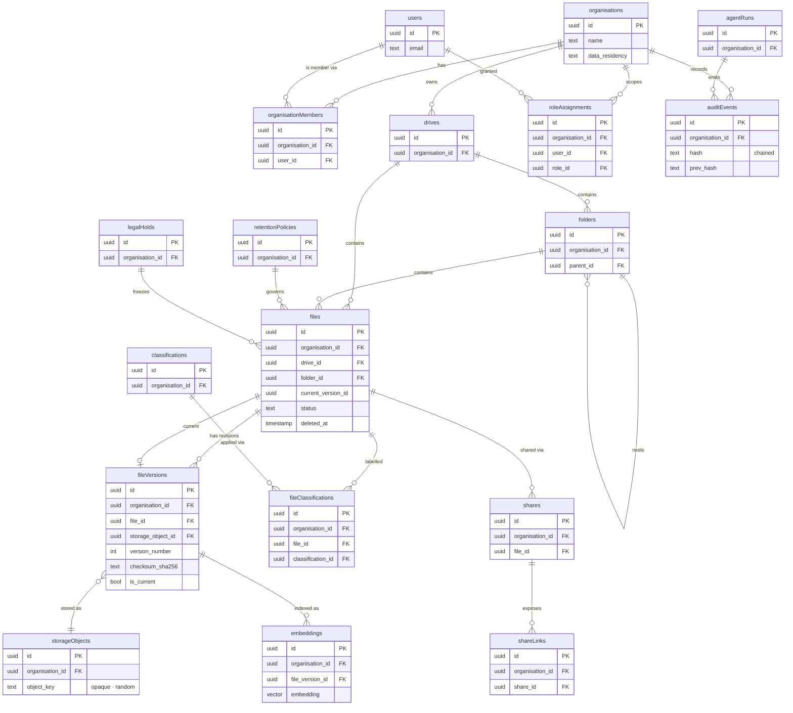

# BlakFile — Data Model

BlakFile's schema is defined with Drizzle ORM as **95 tables** under
`src/db/schema/*.ts`, re-exported from a single barrel (`src/db/schema/index.ts`)
and grouped by domain. This document explains the modelling conventions, shows an
ER diagram of the core entities, and maps every table to its owning module.

For how these tables are isolated per tenant, see
[`tenant-isolation.md`](./tenant-isolation.md). For the surrounding architecture,
see [`architecture.md`](./architecture.md).

## Modelling conventions

These conventions are enforced consistently; consistency here is a security
property, not cosmetics. The shared helpers live in `src/db/schema/_shared.ts`.

- **UUID primary keys.** Every table's primary key is `id uuid`, generated
  in-database via `gen_random_uuid()` (`pk()` helper). No sequential integer IDs
  are exposed.
- **`organisationId` tenant key.** Every tenant-scoped row carries
  `organisation_id uuid not null` (`orgId()` helper) and is indexed on it. RLS
  policies key off this column
  (`organisation_id = current_setting('app.current_org')::uuid`). A tenant-scoped
  table without `organisationId` is a review failure.
- **Timestamps everywhere.** `created_at` and `updated_at` (timezone-aware,
  `updated_at` auto-touched) appear on virtually every table via the
  `timestamps` helper.
- **Actor attribution.** Where an action's originator matters, rows carry
  `actor_type` / `actor_id`. `actor_type` is nullable and may be
  `user`, `service_account`, `api_client`, `agent`, `system`, `external_user`
  or `anonymous`, so system- and agent-initiated actions are attributable, not
  just user actions.
- **Secrets are never stored in plaintext.** Sensitive material is persisted as
  a **reference** or a **hash**, never the value. Encryption keys are held as
  `encryptionKeyReferences` (a pointer into the KMS/key store, not the key
  itself); tokens and credentials are stored as digests (`*Hash`). The
  application cannot leak a secret it does not hold.
- **JSONB only for genuinely flexible metadata.** Columns such as `provenance`
  and custom metadata values use `jsonb`. Anything that is queried, joined,
  constrained or authorised on is a first-class typed column, not a JSON blob.
- **Foreign keys are declared** with explicit `onDelete` behaviour
  (`cascade` / `set null` / restrict) to keep referential integrity in the
  database. (A small number of intentional cycles — for example
  `files.current_version_id` ↔ `file_versions` — are broken by leaving one side
  nullable and without an inline FK.)
- **Soft-delete is the exception, not the rule.** A `deleted_at` column exists
  only where user-visible restore semantics justify it (for example `files`).
  **Soft-delete is never used as a retention mechanism.** Retention and
  disposition are governed explicitly by the `retention` and `legal-hold`
  modules; audit rows are append-only and are never soft- or hard-deleted by the
  application.

### File identity vs version identity

`files` models the **logical file** (its identity, name, owner, drive/folder
placement, lifecycle status). `fileVersions` models an **immutable content
revision** — a specific set of bytes with its own checksum and storage object.

- A file points at its current version via `files.current_version_id`.
- Each version references exactly one `storageObjects` row (the opaque blob).
- **Derived content binds to a `fileVersion`, not the file.** Previews,
  extracted text and embeddings are all keyed to a version, so re-indexing after
  a new upload never mixes content across revisions, and superseded content can
  be reasoned about and disposed of precisely.

## Core entity–relationship diagram

This shows the **core** entities only. The full schema is 95 tables (see the map
below).

## Table-to-module map

All 95 tables, grouped by the schema file / owning module.

| Module (schema file) | Tables | Purpose |
| --- | --- | --- |
| `organisations` | organisations, organisationDomains, organisationMembers, teams, teamMembers, groups, groupMembers | Tenants, verified domains, membership, and team/group structures. |
| `identity` | users, sessions, accounts, passkeys, mfaFactors, recoveryCodes, trustedDevices | Principals and their authentication factors (Better Auth backed). |
| `identity-providers` | identityProviders, samlConfigurations, oidcConfigurations, scimConfigurations, scimTokens | Enterprise SSO (SAML/OIDC) and SCIM provisioning config. |
| `authorisation` | roles, permissions, roleAssignments, accessRequests, accessReviews | RBAC definitions, grants and access-governance workflows. |
| `workspaces` | workspaces, workspaceMembers, drives, folders | Workspace containers, membership, drives and folder hierarchy. |
| `files` | files, fileVersions, fileLocks | Logical files, immutable content versions, check-out locks. |
| `storage` | storageProviders, encryptionKeyReferences, storageObjects | Storage driver config, KMS key pointers, opaque blob records. |
| `uploads` | uploadSessions, multipartUploadParts | Resumable/multipart upload session and part tracking. |
| `previews` | previews, extractedText | Rendered previews and extracted text (bound to a version). |
| `metadata` | tags, fileTags, labels, metadataSchemas, metadataFields, fileMetadataValues | Tags, labels and custom metadata schemas/values. |
| `classifications` | classifications, fileClassifications | Sensitivity classifications and their file bindings. |
| `retention` | retentionPolicies, retentionAssignments, dispositionReviews | Retention rules, their assignment, and disposition review. |
| `legal-hold` | legalHolds, legalHoldResources | Legal holds and the resources they freeze. |
| `dlp` | dlpScans, dlpFindings | Data-loss-prevention scans and findings. |
| `malware` | malwareScans | Malware scan orchestration and verdicts. |
| `sharing` | shares, shareRecipients, shareLinks, shareAccessEvents | Internal shares, recipients, links and link-access events. |
| `external-collaboration` (`external`) | externalUsers, invitations, fileRequests, fileRequestSubmissions | External participants, invitations and inbound file requests. |
| `search` | embeddings | pgvector embeddings for semantic search. |
| `ai` | aiProviders, aiPolicies, aiJobs, aiOutputs | AI provider config, per-org AI policy, jobs and outputs. |
| `agents` | agents, agentTools, agentRuns, agentRunSteps, agentApprovals | Agent definitions, tools, runs, steps and human approvals. |
| `mcp` | mcpClients, mcpSessions, mcpToolInvocations | MCP clients, sessions and tool-invocation audit. |
| `api` | apiClients, apiCredentials, serviceAccounts, oauthClients | Programmatic access: clients, credentials, service accounts, OAuth. |
| `webhooks` | webhooks, webhookEvents, webhookDeliveries | Webhook subscriptions, events and delivery attempts. |
| `notifications` | notifications, notificationPreferences | User notifications and preferences. |
| `audit` | auditEvents, securityEvents | Append-only hash-chained audit and security event logs. |
| `usage` | usageRecords, quotas, featureFlags | Usage metering, quotas and feature flags. |
| `processing` | processingJobs | Background processing job records (queue-backed work). |

> The `administration`, `integrations` and `billing` domains provide services
> over the tables above and over integration/billing state; the 95 counted
> tables are those defined across the schema files listed here.

## Related documents

- [`architecture.md`](./architecture.md) — platform architecture and domain
  module map.
- [`tenant-isolation.md`](./tenant-isolation.md) — how `organisationId` and RLS
  enforce the tenant boundary end to end.
