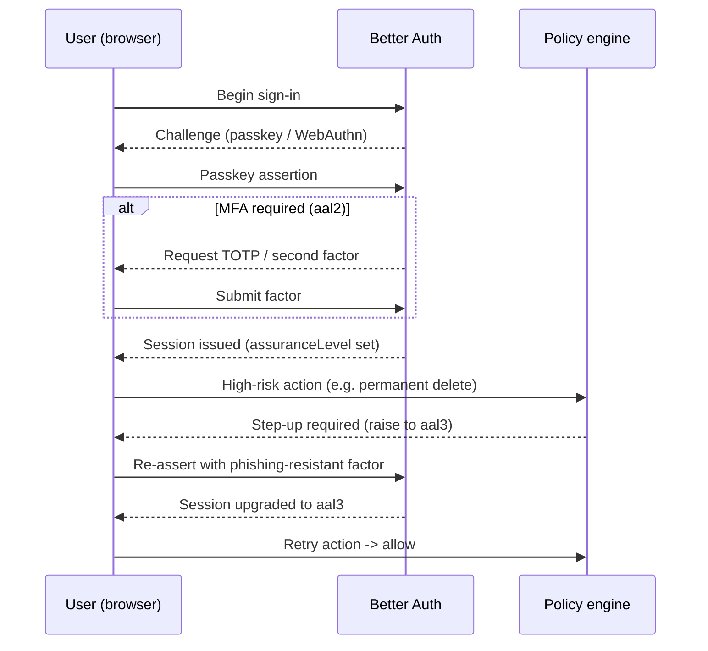

# Security Model

This document describes the concrete controls BlakFile applies, mapped to a
threat list, and the platform defaults that make the system secure without
operator configuration. Authorisation logic is covered in
[authorisation-model.md](./authorisation-model.md); adversarial analysis in
[threat-model.md](./threat-model.md).

## Security-by-default posture

- Links are **private** by default; anonymous/public access is **off**.
- Signed URLs are short-lived (**120 seconds**) and object keys are **opaque
  and random**.
- Authorisation is checked at **every server boundary** and re-checked before
  **every agent/MCP tool call**. No client-side filtering is treated as a
  security control.
- High-risk actions require **step-up authentication**.
- AI features are **off by default** and provider-neutral.
- All secrets are stored as **KMS references (`*Ref`)** or **hashes (`*Hash`)**,
  never plaintext.

## Threat-to-control mapping

| Threat | Control | Where enforced |
| --- | --- | --- |
| CSRF | SameSite=Lax/Strict cookies, origin/`Origin`+`Sec-Fetch` validation on mutations, Server Actions bound to same-origin | Middleware, Server Actions, route handlers |
| XSS | Per-request nonce CSP (no `unsafe-inline`), React auto-escaping, sanitised rich text, `X-Content-Type-Options: nosniff` | Middleware CSP, rendering layer |
| SQL injection | Parameterised queries only via Drizzle; no string-built SQL | Data-access layer |
| SSRF | Egress allow-list for outbound fetches (webhooks, SSO metadata, AI providers); block link-local/metadata/private ranges; DNS-rebinding guard | Outbound HTTP client, webhook/SSO/AI callers |
| Path traversal | No filename-derived paths; storage keys are random opaque tokens; normalised names for display only | Storage layer (`storageObjects.objectKey`) |
| Open redirect | Redirect targets restricted to a same-origin/allow-listed set; no user-controlled absolute URLs | Auth/callback handlers |
| IDOR | Object references resolved only within `withOrg`; policy engine authorises every resource by id; opaque keys | Policy engine + RLS |
| Broken access control | Centralised `authorize()` at every boundary; deny-overrides; RLS backstop | Policy engine + PostgreSQL RLS |
| Mass assignment | Explicit server-side field allow-lists (Zod/DTO); no blind object spread into rows | Input validation layer |
| Prototype pollution | Safe JSON parsing, no recursive merge of untrusted objects, `Object.create(null)` maps | Input validation layer |
| Unsafe file parsing | Parsing/preview/extraction runs in sandboxed workers with resource limits; untrusted-format libraries isolated | Upload/processing pipeline (BullMQ workers) |
| Zip bombs | Decompression ratio and output-size caps; entry-count limits; abort on breach | Upload pipeline |
| MIME confusion | Content sniffing (`detectedContentType`) compared to declared type; `nosniff`; serve with safe response types | Upload pipeline, download handler |
| Malicious SVG | SVG never served inline from user origin; sanitised or rasterised to a preview; served as attachment | Preview pipeline, download handler |
| CSV formula injection | Neutralise leading `= + - @` / control chars on export | Export/CSV writer |
| Clickjacking | `X-Frame-Options: DENY` + CSP `frame-ancestors 'none'` | `next.config.ts` headers + middleware CSP |
| Session fixation | New session/token minted on authentication and on privilege change; no client-set session id | Better Auth |
| Token leakage | Tokens hashed at rest (`*Hash`); short signed URLs; `Referrer-Policy` limits leakage; tokens never in logs/audit | Auth, storage, audit |
| Replay | Short URL TTL (120 s), one-time links, WebAuthn counter checks, nonce/state on SSO | Storage, sharing, Better Auth |
| Brute force | Per-identity + per-IP rate limits and progressive lockout | Auth middleware, rate limiter |
| Credential stuffing | Passkey-first auth, MFA, breached-password checks, anomaly/velocity detection | Better Auth, `securityEvents` |
| Enumeration | Uniform responses/timing for login/reset/link lookup; opaque tokens; rate limits | Auth, sharing, rate limiter |
| Cache poisoning | Explicit `Vary`, no caching of authenticated responses, keyed cache | Response headers, CDN config |
| Cross-tenant cache leakage | Cache keys namespaced by `organisationId`; per-tenant isolation of derived data | Caching layer |
| Search / embedding leakage | Vector and full-text queries scoped by `organisationId` under RLS; results re-authorised per file | Search layer + RLS + policy engine |
| Prompt injection | Untrusted document content treated as data, not instructions; agent permissions never derived from content; per-tool authorisation | AI/agent runtime + policy engine |
| Agent tool abuse | Agents hold no ambient permission; `authorize()` before every tool call; approval thresholds for destructive tools; full run/step audit | Agent runtime + policy engine |
| Webhook forgery | Outbound HMAC signatures (KMS `secretRef`); inbound verification, timestamp + replay window | Webhook subsystem |
| API-key leakage | Keys stored hashed (`keyHash`), shown once; non-secret `prefix` for display; IP allow-lists; revocation | API subsystem |
| Supply chain | Pinned/locked deps, dependency + secret + container scanning, SBOM generation, provenance | CI/CD pipeline |

## HTTP headers and cookies

Transport-level headers are set statically in `next.config.ts`:

- `X-Content-Type-Options: nosniff`
- `X-Frame-Options: DENY`
- `Referrer-Policy: strict-origin-when-cross-origin`
- `Cross-Origin-Opener-Policy: same-origin`
- `Cross-Origin-Resource-Policy: same-origin`
- `Permissions-Policy: camera=(), microphone=(), geolocation=()`
- `Strict-Transport-Security: max-age=63072000; includeSubDomains; preload`

The **Content-Security-Policy is applied per request in middleware with a fresh
nonce**, so scripts are allow-listed by nonce rather than `unsafe-inline`. The
CSP also sets `frame-ancestors 'none'` (reinforcing `X-Frame-Options`) and a
restrictive `default-src`.

Cookies are:

- `HttpOnly` — never readable by JavaScript.
- `Secure` — only sent over HTTPS.
- `SameSite=Lax` (or `Strict` for sensitive flows) — CSRF mitigation.

Mutations additionally validate request **origin** (`Origin`/`Sec-Fetch-*`) so a
cross-site request cannot drive a state change even if a cookie is attached.

## Authentication flow

## Secrets handling

Nothing sensitive is stored in plaintext. Secrets are held either as an external
**KMS reference (`*Ref`)** — a pointer to key material held in AWS KMS / Azure
Key Vault / GCP KMS / Vault — or as an irreversible **hash (`*Hash`)**.

Must **never** be persisted in plaintext:

| Secret | Storage form | Table/field |
| --- | --- | --- |
| API keys / credentials | Hash + display prefix | `apiCredentials.keyHash`, `.prefix` |
| OAuth client secrets | Hash | `oauthClients.clientSecretHash` |
| OIDC client secret | KMS ref | `oidcConfigurations.clientSecretRef` |
| SAML signing certificate | KMS ref | `samlConfigurations.x509CertRef` |
| Webhook signing key | KMS ref | `webhooks.secretRef` |
| SCIM bearer tokens | Hash | `scimTokens.tokenHash` |
| Signed-URL / object signing keys | KMS ref | `encryptionKeyReferences.keyRef` (purpose `signing`) |
| Recovery codes | Hash | `recoveryCodes.codeHash` |
| MFA/TOTP secrets | KMS ref | `mfaFactors.secretRef` |
| Share-link passwords | Hash | `shareLinks.passwordHash` |
| AI provider keys | KMS ref | `aiProviders.apiKeyRef` |
| Object storage credentials | KMS ref | `storageProviders.credentialsRef` |
| Service-account/agent credentials | KMS ref | `serviceAccounts.credentialRef`, `agents.credentialRef` |
| MCP session tokens | Hash | `mcpSessions.tokenHash` |

The audit log (`auditEvents`) is likewise forbidden from containing file
contents, passwords, tokens or keys — only references, hashes and non-sensitive
metadata.

## Signed URL rules

- Issued only after `canDownloadFile`/`canPreviewFile` allows.
- **TTL of 120 seconds**; single logical use where the flow permits it.
- Signed with a KMS-referenced signing key.
- Bound to the specific object and HTTP method; no directory-level grants.
- Obligations from the policy decision (e.g. watermark) are applied before the
  URL is minted, not after.

## Object-key rules

- `storageObjects.objectKey` is a **random, opaque token**.
- It MUST NOT embed the filename, tenant id, user id, or any user-supplied data.
- Enumeration resistance and tenant isolation depend on unguessable keys;
  display names are stored separately (`files.name` / `normalisedName`).

## Rate limiting, lockout and size limits

- **Rate limiting** per identity, per IP and per API client (Redis-backed);
  breaches raise `securityEvents` (`rate_limit`, `enumeration`).
- **Brute-force lockout** with progressive backoff on authentication and
  share-link password attempts; `brute_force` security events emitted.
- **Request body limit** — Server Actions capped at `2mb` (`next.config.ts`);
  API request bodies bounded per route.
- **Upload limits** — maximum object size and per-tenant quota enforced; large
  uploads use multipart with server-side size verification against declared
  size.

## Supply chain and build integrity

- Dependencies are locked and pinned; **dependency scanning** in CI.
- **Secret scanning** on every commit/PR blocks credential leakage.
- **Container image scanning** on build.
- A **Software Bill of Materials (SBOM)** is generated per release for
  provenance and vulnerability tracking.
