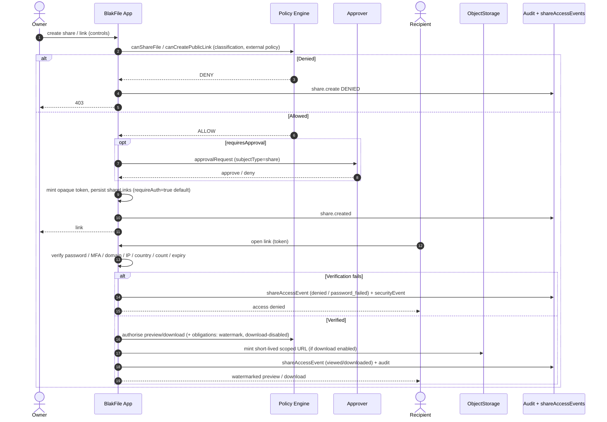

# Sharing Model

> Applies to: BlakFile — secure, AI-native, multi-tenant enterprise file platform.
> Principle: **secure-by-default**. Public and anonymous access is OFF unless a policy explicitly permits it, and every share access is logged.

BlakFile supports rich internal and external collaboration while keeping sharing controls conservative by default: links expire, authentication is required, downloads are disabled until enabled, and tokens are enumeration-resistant.

---

## 1. Sharing types

A `shares` row grants access to exactly one of a file, folder, or drive, at a `permissionLevel` (`viewer` → `downloader` → `commenter` → `editor` → `manager` → `owner`). The `shareTypeEnum` covers:

| Type | Description |
| --- | --- |
| `user` | Direct grant to a named organisation user. |
| `group` | Grant to a group. |
| `team` | Grant to a team. |
| `workspace` | Grant to all members of a workspace. |
| `external_email` | Grant to a guest identified by email (`externalUsers` / `invitations`). |
| `link` | Tokenised share link (`shareLinks`). |
| `file_request` | Inbound upload-only collection (`fileRequests`). |

Recipients are recorded in `shareRecipients` (`principalType`: `user` | `group` | `team` | `external_user`), with `email` for external guests and `acceptedAt` for invitation acceptance.

### Secure-link controls (`shareLinks`)

| Control | Column | Default | Effect |
| --- | --- | --- | --- |
| Expiry | `expiresAt` | **On** | Links are time-bounded by default. |
| Password | `passwordHash` | — | Hashed, never plaintext. |
| Require auth | `requireAuth` | **`true`** | Public/anonymous access is **OFF by default**. |
| Require MFA | `requireMfa` | `false` | Step-up authentication before access. |
| Domain restriction | `allowedDomains` | — | Restrict to recipient email domains. |
| IP restriction | `allowedIpRanges` | — | Restrict to CIDR ranges. |
| Country restriction | `allowedCountries` | — | Geo-restrict access. |
| Max access count | `maxAccessCount` / `accessCount` | — | Cap total accesses. |
| One-time | `oneTime` | `false` | Single-use link. |
| Download control | `downloadEnabled` | **`false`** | Preview-only unless explicitly enabled. |
| Watermark | `watermark` | `false` | Apply dynamic watermark to previews/downloads. |
| Opaque token | `token` | — | Enumeration-resistant, unique random secret. |

The `token` is an opaque, high-entropy value (unique index) so links cannot be guessed or enumerated. `requireAuth` defaulting to `true` means anonymous public links are an explicit, policy-gated opt-in — never the default.

---

## 2. Access logging, detection & revocation

- **Per-access logging.** Every access writes a `shareAccessEvents` row (`action`: `viewed` | `downloaded` | `denied` | `password_failed`), capturing IP, user agent, country, recipient email, and the `fileVersionId` served.
- **Suspicious sharing detection.** Access streams feed detection; anomalies (impossible travel, password brute force, unusual geography, enumeration) raise `securityEvents` (`type`: `suspicious_share`, `enumeration`, `brute_force`, …) for triage.
- **Revocation.** A single link/share is revoked via `revokedAt`; bulk revocation clears all links for a resource, owner, or campaign in one action. Revocation takes effect immediately — the next access is denied and logged.

---

## 3. Data rooms

Data rooms are secure, participant-scoped spaces (a `workspaces`/`drives` container of type `data_room`) for due diligence and controlled external distribution.

- **Named participants & access periods.** Participants are enrolled via workspace membership with time-bounded access windows.
- **Watermarks.** Per-document dynamic watermarking (viewer identity, timestamp) on previews and downloads.
- **Terms / attestations.** Participants accept terms or attestations (recorded via `approvalRequests` / acceptance events) before content is released.
- **Per-document access reporting.** `shareAccessEvents` provide per-participant, per-document view/download reporting for the room.
- **Q&A.** Threaded questions and answers are handled through the collaboration layer (`comments`, `mentions`, `tasks`) scoped to the data room.

---

## 4. External-sharing policy & approval workflows

External sharing is policy-governed. When policy requires it, a share is created with `shares.requiresApproval = true` and released only after sign-off.

- **Policy checks.** `canShareFile` and `canCreatePublicLink` are evaluated against the actor, resource classification (`handlingRules`), and org external-sharing policy before any link exists.
- **Approval workflow.** A pending `approvalRequests` row (`subjectType = share`) captures the request, approver, `policyVersion`, and decision. The link is inert until `status = approved`.
- **Guests & invitations.** External recipients are provisioned as `externalUsers` via tokenised `invitations`, with expiry and revocation.

---

## 5. Sharing flow

Every branch — creation, approval, verification failure, and successful access — is written to the audit log and, for access, to `shareAccessEvents`. Download URLs are always short-lived, scope-limited, and authorised server-side first (see `storage-architecture.md`).
