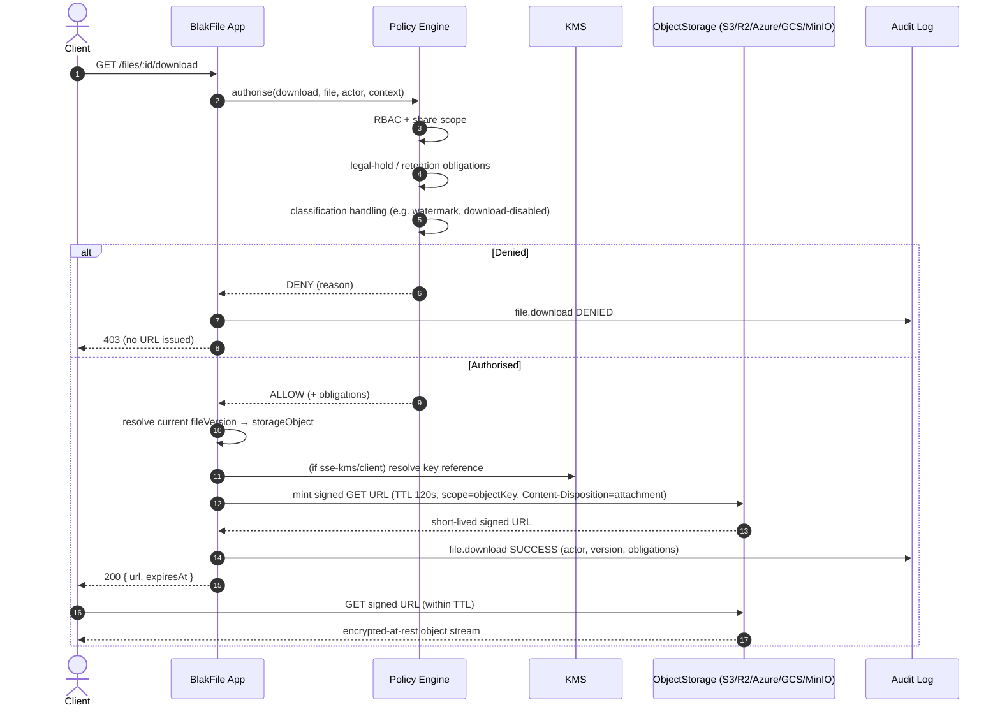

# Storage Architecture

> Applies to: BlakFile — secure, AI-native, multi-tenant enterprise file platform.
> Audience: platform engineers, security architects, compliance reviewers.

BlakFile treats object storage as a **replaceable, untrusted commodity**. Bytes at rest are encrypted, keyed to opaque identifiers, and reachable only through short-lived, server-authorised, scope-limited URLs. No tenant, filename, or user-supplied string ever appears in a storage key, and the domain layer never binds itself to a single vendor.

---

## 1. The pluggable `ObjectStorage` interface

Every storage backend — Amazon S3, Cloudflare R2, Azure Blob, Google Cloud Storage, MinIO, or a local filesystem in development — is reached through a single provider-neutral interface. The domain and application layers depend on this interface, **never on a vendor SDK**.

```ts
interface ObjectStorage {
  createUploadUrl(input: CreateUploadUrlInput): Promise<SignedUpload>;
  createMultipartUpload(input: CreateMultipartInput): Promise<MultipartHandle>;
  completeMultipart(input: CompleteMultipartInput): Promise<CompletedObject>;
  getSignedDownloadUrl(input: SignedDownloadInput): Promise<SignedUrl>;
  getObjectStream(input: ObjectRef): Promise<ReadableStream>;
  deleteObject(input: ObjectRef): Promise<void>;
  copyObject(input: CopyObjectInput): Promise<CopiedObject>;
}
```

| Method | Responsibility |
| --- | --- |
| `createUploadUrl` | Mint a short-lived, single-object PUT URL for a small (single-part) upload. |
| `createMultipartUpload` | Begin a provider multipart upload; returns `storageUploadId`. |
| `completeMultipart` | Assemble parts (verified by `partNumber` + `etag`) into a final object. |
| `getSignedDownloadUrl` | Mint a short-lived, scope-limited GET URL with forced `Content-Disposition`. |
| `getObjectStream` | Server-side streaming read (scanning, OCR, preview, CDR) — never exposed to clients. |
| `deleteObject` | Remove a stored object (subject to legal-hold / retention gates upstream). |
| `copyObject` | Server-side copy (version promotion, cross-region replication, export). |

### Why the domain layer never imports a vendor SDK

- **Portability & residency.** A tenant in Australia may require `ap-southeast-2` on AWS; another may mandate Azure in-country. The driver is chosen per organisation via `storageProviders.driver`, not compiled into business logic.
- **Testability.** The `local` and `minio` drivers make the full upload/download pipeline runnable in CI and on a laptop.
- **Blast-radius control.** Credentials are resolved through `storageProviders.credentialsRef` (a KMS reference), so a leaked SDK object or stack trace never carries a plaintext secret.
- **Uniform security posture.** Signed-URL TTLs, forced download disposition, and checksum verification are enforced in the abstraction, so no single call site can weaken them.

The concrete backend is a row in `storageProviders` (`driver`, `region`, `bucket`, `endpoint`, `credentialsRef`), resolved per organisation. `isDefault` selects the fallback provider for a tenant.

---

## 2. Object key strategy

`storageObjects.objectKey` is a **random, opaque** identifier. It must never embed the filename, tenant identifier, user id, or any user-controlled data.

```
orgshard/9f3c2a7e1b8d4f60a1c5e9d2f7b0a3c8
└──────┘ └──────────────────────────────┘
 residency /       cryptographically random suffix
 org shard         (no filename, no tenant id, no PII)
```

- **Human-meaningful metadata lives only in the database.** The filename, MIME type, owner, and folder are columns on `files` (`name`, `mimeType`, `ownerId`, `folderId`). The storage tier knows nothing about them.
- **Enumeration resistance.** Because keys are unguessable random values, an attacker who obtains one key learns nothing about neighbouring objects and cannot walk a tenant's data.
- **Tenant isolation & residency.** Each organisation is pinned to its own bucket/prefix via `storageProviders.bucket` (and optional per-drive prefixing), so a misconfigured policy cannot cross tenant boundaries at the storage layer. `storageObjects` carries `organisationId`, enforced by row-level security in PostgreSQL.
- **Stable identity vs mutable content.** A logical `files` row keeps a stable `id` across edits; each immutable `fileVersions` row points at exactly one `storageObjects` row. Re-uploads create new random keys — content is never overwritten in place.

The unique index on `(storageProviderId, objectKey)` guarantees no key collision within a provider.

---

## 3. Encryption

### 3.1 At rest

Every `storageObjects` row records how it is protected via `sseMode`:

| `sseMode` | Meaning |
| --- | --- |
| `sse-s3` | Provider-managed server-side encryption (baseline). |
| `sse-kms` | Server-side encryption with a customer-managed KMS key (`encryptionKeyId`). |
| `client` | Client-side / envelope encryption; the object is ciphertext before it leaves the app tier. |

### 3.2 Envelope encryption & BYOK

Key material is never stored in BlakFile. `encryptionKeyReferences` holds only a **pointer** (`keyRef`) into an external KMS (`kmsDriver`: `aws-kms` | `azure-kv` | `gcp-kms` | `vault` | `local`), plus a `purpose` (`object` | `field` | `signing`).

- A per-object **data encryption key (DEK)** encrypts the bytes.
- The DEK is wrapped by a tenant **key encryption key (KEK)** held in the customer's KMS — the essence of **BYOK / customer-managed keys**.
- `storageObjects.encryptionKeyId` binds each object to the key reference used, so key lineage is always auditable.

### 3.3 Rotation

`encryptionKeyReferences.rotatedAt` and `retiredAt` track the rotation lifecycle. Because objects reference a key *by id*, rotation issues a new KEK version without rewriting object bodies; old references are marked `retiredAt` once no live object depends on them.

### 3.4 Cryptographic erase

Destroying the KEK in the customer KMS renders every DEK — and therefore every object body wrapped by it — permanently unrecoverable. This provides **cryptographic erasure**: an authoritative, verifiable deletion primitive even when a backend cannot guarantee immediate physical overwrite. See `data-lifecycle.md` for how this composes with retention and legal-hold gates.

---

## 4. Signed URL rules

Signed URLs are the **only** way a browser touches storage, and they are deliberately weak on their own.

- **Short TTL.** Default **120 seconds**. Long enough to start a transfer, too short to circulate.
- **Scope-limited.** A URL is minted for exactly one object and one operation (GET or PUT); it grants nothing else.
- **Authorised server-side *first*.** BlakFile evaluates the policy engine — permission level, classification handling rules, legal hold, retention state — **before** any URL is minted. The URL is a consequence of an authorisation decision, never a substitute for one.
- **Forced download disposition.** Download URLs set `Content-Disposition: attachment; filename="…"` so sensitive content is not rendered inline in a shared browser context.
- **No caching of sensitive responses.** Cache-control headers prevent intermediaries and browsers from retaining sensitive bodies.
- **No permanent URLs, ever.** BlakFile never persists or exposes a durable storage URL. Every access re-runs authorisation and re-mints.

---

## 5. Data residency

- **Per-org and per-drive residency.** `drives.dataResidency` and `files.dataResidency` pin content to a region; a tenant can operate multiple residency zones.
- **Region-pinned providers.** `storageProviders.region` binds a backend to a jurisdiction; residency selection maps a drive to a compatible provider.
- **Australian sovereign default.** New organisations default to `ap-southeast-2` (`DEFAULT_DATA_RESIDENCY`), keeping data onshore unless a tenant explicitly elects otherwise.
- Residency is validated at upload time: a file's declared/derived `dataResidency` must resolve to a provider in a permitted region before an object key is issued.

---

## 6. Download flow

Authorisation always precedes URL minting. A failed policy check yields a denied, audited event and **no** signed URL.



Key guarantees: authorisation happens **before** the URL exists; obligations (watermark, forced download, one-time) travel with the decision; every download attempt — allowed or denied — is written to the append-only audit log.
