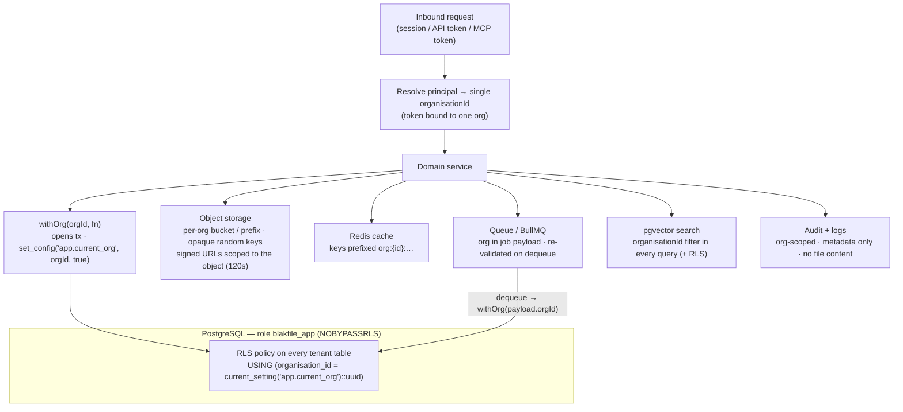

# BlakFile — Tenant Isolation

BlakFile is multi-tenant on shared infrastructure. This document specifies the
tenant-isolation guarantee, the mechanism enforcing it at each layer, how each
layer fails closed, and how the guarantee is tested.

See also [`architecture.md`](./architecture.md) and
[`data-model.md`](./data-model.md).

## The guarantee

> A principal authenticated for one organisation cannot read, write, enumerate,
> infer or otherwise access another organisation's data — at the **application**,
> **database**, **storage**, **cache**, **queue**, **search/embedding** and
> **logging** layers.

Isolation is enforced in depth. No single layer is trusted to be the only
boundary; a defect in one layer does not, on its own, expose another tenant's
data. In particular, tenant scoping is **never** implemented by filtering results
in the client.

## How org context flows

Every request establishes a single, unforgeable organisation context and carries
it through every layer. The database boundary (RLS) is authoritative: even a
domain-service query that forgot to filter returns nothing for the wrong tenant.

## Per-layer controls

| Layer | Mechanism | Failure-closed behaviour |
| --- | --- | --- |
| **Database** | PostgreSQL Row-Level Security on every tenant table, keyed on the session variable `app.current_org`. The app connects as `blakfile_app`, a low-privilege role with **`NOBYPASSRLS`**. `withOrg(orgId, fn)` is the only sanctioned way to run tenant queries: it opens a transaction and calls `set_config('app.current_org', orgId, true)` (transaction-scoped, so it cannot leak across pooled connections). | If `app.current_org` is unset, `current_setting(...)` errors / the RLS predicate matches no rows, so tenant queries return **nothing** rather than everything. The app role cannot bypass RLS even with a raw query. A query that omits an `organisationId` filter is still constrained by RLS. |
| **Storage** | Per-organisation bucket or key prefix. Object keys are **opaque and random** — they contain no filename, path or tenant identifier. Access is only ever via short-lived (**120s**) signed URLs scoped to a single object. | A leaked or guessed key is not derivable from any tenant attribute; signed URLs expire in seconds and grant access to exactly one object. Without a valid signed URL, direct object access is denied by the storage backend. |
| **Cache (Redis)** | All cache keys are namespaced with the org, e.g. `org:{organisationId}:…`. Cache lookups are constructed from the request's resolved org context, not from client input. | A cache read for one org cannot collide with or read another org's key space; a missing/incorrect namespace yields a cache miss (which re-reads through RLS), never another tenant's cached value. |
| **Queue / jobs** | Every job payload carries its `organisationId`. On dequeue, the worker re-validates the org and re-enters the domain layer via `withOrg(payload.organisationId, …)`, so job processing is subject to the same RLS as a request. Queues/namespaces are org-aware. | A job cannot act outside the org recorded in its payload; processing runs under that org's RLS context, so a malformed or malicious payload cannot reach another tenant's rows. |
| **Search / pgvector** | Every vector and keyword query includes an explicit `organisationId` filter **in addition to** RLS. Embeddings carry `organisationId` and bind to a `fileVersion`. | Even if a query is built incorrectly, RLS on the embeddings table constrains results to the current org; the explicit filter is defence in depth, not the sole control. Cross-org nearest-neighbour matches are impossible. |
| **Audit / logs** | Audit and security events are written per-org (append-only, hash-chained) and record **metadata only — never file content**. Application logs are org-scoped and redact sensitive values. | Reading audit/security events is itself an RLS-protected, org-scoped operation. Logs cannot leak another tenant's content because content is not logged. |
| **MCP / API** | API tokens, OAuth clients, service accounts and MCP client credentials are each **bound to exactly one organisation**. The bound org becomes the request's org context; it cannot be overridden by request parameters. | A token can only ever operate within its bound org. Attempting to reference another org's resources resolves to that org's RLS context and returns nothing / is denied. |

## Testing strategy

Tenant isolation is verified by an adversarial, cross-org test suite whose thesis
is: *set up two organisations, then attempt every cross-org access and assert it
is denied at each layer.*

1. **Fixtures.** Seed Org A and Org B, each with users, drives, files, versions,
   shares, embeddings and audit events. Capture concrete identifiers (file IDs,
   object keys, share link tokens, embedding IDs) from Org B.
2. **Database.** Acting as an Org A principal (via `withOrg(orgA, …)`), attempt
   to read/update/delete Org B rows by ID across the core tables. Assert zero
   rows returned and writes affect nothing. Assert that a query missing an
   explicit org filter is still empty for Org B data. Assert the app role cannot
   `SET ROLE` past RLS and that an unset `app.current_org` yields no rows.
3. **Storage.** Assert Org B object keys are not derivable from Org A context;
   assert a signed URL minted for an Org A object cannot address an Org B object;
   assert expired signed URLs are rejected.
4. **Cache.** Assert Org A cache operations never hit Org B's key namespace, and
   that a namespace collision cannot be induced from client input.
5. **Queue.** Enqueue a job with Org A context but an Org B resource ID; assert
   the worker, running under `withOrg(payload.org)`, cannot touch Org B data and
   the job fails closed.
6. **Search / embeddings.** Run semantic and keyword queries as Org A; assert no
   Org B `fileVersion` or embedding ever appears in results, including
   nearest-neighbour queries seeded with Org B content vectors.
7. **Audit / logs.** Assert Org A cannot read Org B audit or security events, and
   scan emitted logs to assert no file content is present.
8. **MCP / API.** Using an Org A-bound API/MCP token, attempt to reference Org B
   resources and to override the org via parameters; assert every attempt is
   denied and that the bound org cannot be changed.

Every case asserts a **negative** outcome (access denied / empty result), and the
suite runs against the same domain services and `blakfile_app` role used in
production, so it exercises the real RLS policies rather than a relaxed test
configuration.

## Related documents

- [`architecture.md`](./architecture.md) — where the domain layer and policy
  engine sit.
- [`data-model.md`](./data-model.md) — the `organisationId` convention and the
  tables it protects.
