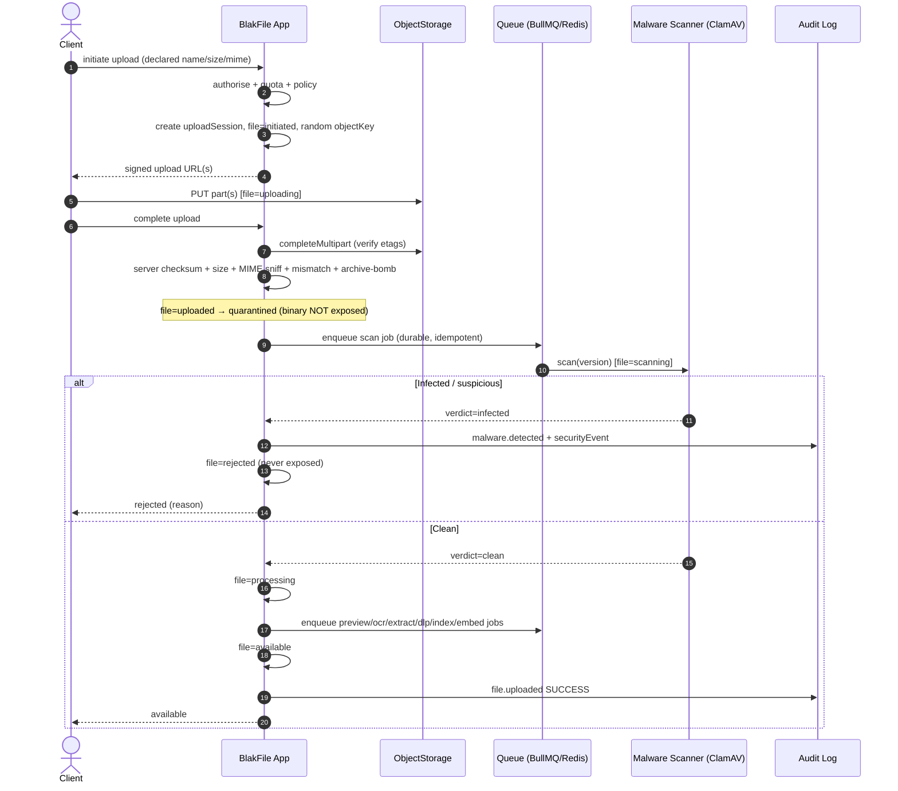
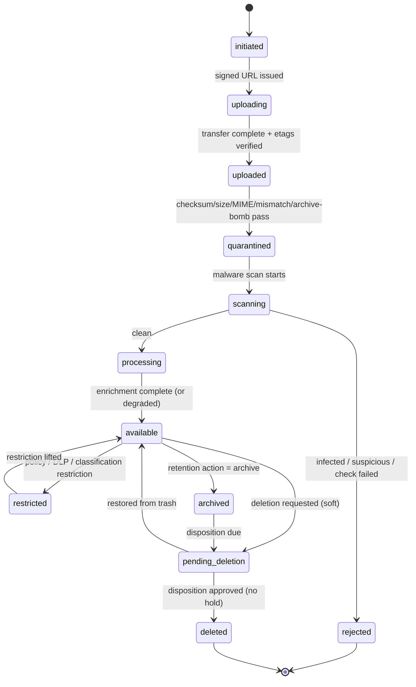

# Secure Upload Pipeline

> Applies to: BlakFile — secure, AI-native, multi-tenant enterprise file platform.
> Principle: **security-by-default**. Untrusted bytes are quarantined and never exposed until every mandatory security check has passed.

BlakFile treats every upload as hostile until proven otherwise. The client's declared name, size, and MIME type are **advisory only** — the trusted values are recomputed server-side. A file's binary remains in a `quarantined` state through malware scanning, and a failed scan **never** results in an available, downloadable file.

---

## 1. The 25-step pipeline

Steps 1–13 are synchronous around the transfer; steps 14–25 run as **durable, idempotent, retry-safe** `processingJobs`. Each job is a separate, restartable stage.

| # | Step | Detail |
| --- | --- | --- |
| 1 | **Authorisation** | Policy engine confirms the actor may create a file in the target drive/folder (`canUploadFile`). |
| 2 | **Quota check** | Verify `drives.quotaBytes` vs `usedBytes` + declared size before accepting. |
| 3 | **Policy evaluation** | Apply drive/classification handling rules (allowed types, max size, external-source rules). |
| 4 | **Upload session** | Create `uploadSessions` (declared name/size/mime, `expiresAt`); `files` row set to `initiated`. |
| 5 | **Random object key** | Allocate an opaque random `storageObjects.objectKey` — never filename/tenant. |
| 6 | **Signed upload URL** | Mint a short-lived, scope-limited PUT (or begin multipart) via `ObjectStorage`. |
| 7 | **Multipart transfer** | Client uploads parts; each recorded in `multipartUploadParts` (`partNumber`, `etag`). File → `uploading`. |
| 8 | **Client + server checksum** | Compare client-declared `checksumSha256` to server-recomputed digest; mismatch → reject. |
| 9 | **Size validation** | Confirm actual stored bytes match declared/quota-bounded size; oversize → reject. |
| 10 | **MIME detection** | Sniff true content type from magic bytes into `files.detectedContentType`. Browser MIME is never trusted. |
| 11 | **Extension/MIME mismatch** | Reject or flag where extension, declared MIME, and detected type disagree. |
| 12 | **Archive-bomb detection** | Inspect archives for decompression ratio / nesting; reject zip/quine bombs. File → `uploaded` then `quarantined`. |
| 13 | **Malware scan (mandatory)** | ClamAV (abstracted) scans the version. File → `scanning`; `malwareStatus` recorded in `malwareScans`. |
| 14 | **CDR (optional)** | Content Disarm & Reconstruction sanitises active content where enabled. |
| 15 | **Metadata extraction** | Pull document/media metadata (author, pages, dimensions, EXIF handling). |
| 16 | **Preview generation** | Render thumbnail/PDF/image/text into `previews`, bound to the file version. |
| 17 | **OCR** | Extract text from images/scans into `extractedText` (`source = ocr`). |
| 18 | **DLP inspection** | `dlpScans` / `dlpFindings`; only **redacted** samples stored, never raw sensitive matches. |
| 19 | **Classification suggestion** | Suggest a sensitivity label (`fileClassifications.source = ai_suggested`), pending confirmation. |
| 20 | **Search indexing** | Index extracted text (Postgres FTS / `tsvector`) for retrieval. |
| 21 | **Embeddings (if enabled)** | If AI is enabled (off by default), generate vector `embeddings` bound to the `fileVersion`. |
| 22 | **Audit** | Append `file.uploaded` and per-stage outcomes to the tamper-evident audit log. |
| 23 | **Notification** | Notify owner/subscribers that the file is available (or was rejected). |
| 24 | **Availability transition** | Only after all mandatory checks pass does the file move to `available`. |
| 25 | **Webhooks/events** | Emit `file.uploaded` (and `malware.detected` on failure) to subscribed webhooks. |

> **Hard rule:** steps 8–13 are mandatory gates. The binary stays `quarantined`/`scanning` and is unreachable by any download path until they succeed. Post-availability enrichment (15–21) failing degrades features (no preview, no OCR) but never blocks security.

---

## 2. Upload flow — sequence and status transitions



### File status transitions

```
initiated → uploading → uploaded → quarantined → scanning → ┬─ rejected  (terminal for this binary)
                                                             └─ processing → available
```

The binary stays **quarantined** until mandatory security checks pass. A failed scan drives the file to `rejected` and **never** transitions it to `available`.

---

## 3. `fileStatus` state diagram



`pending_deletion` is recoverable (trash); `deleted` is terminal. Neither transition may occur while a legal hold or unexpired retention applies — see `data-lifecycle.md`.

---

## 4. Durable, idempotent processing jobs

Each enrichment stage is a row in `processingJobs` (`type`: `scan` | `ocr` | `preview` | `extract` | `embed` | `index` | `retention` | …) mirrored onto the BullMQ/Redis queue.

- **Durable.** The job record survives worker restarts; the database, not the queue, is the source of truth.
- **Idempotent.** Jobs key off `(resourceType, resourceId, type)` and derive outputs from the immutable `fileVersion` (content hash), so re-running a completed stage is a no-op — safe under at-least-once delivery.
- **Retry-safe.** `attempts` / `maxAttempts` (default 5) with backoff via `scheduledAt`; exhaustion moves the job to `failed` and raises an operator signal without corrupting file state.
- **Correlated.** `correlationId` threads related jobs (scan → preview → index) for tracing and audit.
- **Version-bound.** Because previews, extracted text, and embeddings bind to a `fileVersion`, re-uploads never mix content across versions.

---

## 5. Failure handling

| Failure | Handling |
| --- | --- |
| **Rejected file** (checksum/size/MIME mismatch, archive bomb) | File → `rejected`; binary never exposed; reason audited; session marked failed. |
| **Virus detected** | `malwareScans.status = infected`; emit `malware.detected` webhook + write `securityEvents` (`type = malware_detected`); file → `rejected`; quarantined object scheduled for secure deletion. |
| **Partial multipart** | Incomplete `multipartUploadParts` + provider `storageUploadId` are aborted and cleaned up; no `fileVersion` is created. |
| **Expired session** | `uploadSessions.expiresAt` passed → session `expired`; any orphaned parts/objects garbage-collected; `files` row in `initiated`/`uploading` reaped. |
| **Enrichment failure** (preview/OCR/DLP) | Stage marked `failed` and retried; file remains `available` with degraded features — enrichment never gates security. |

A failed or infected scan is a **terminal security decision**: there is no code path that promotes such a file to `available` or mints a download URL for it.
